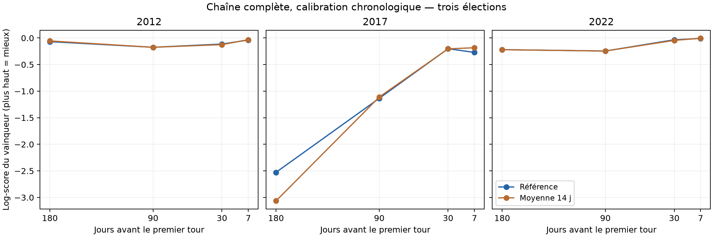
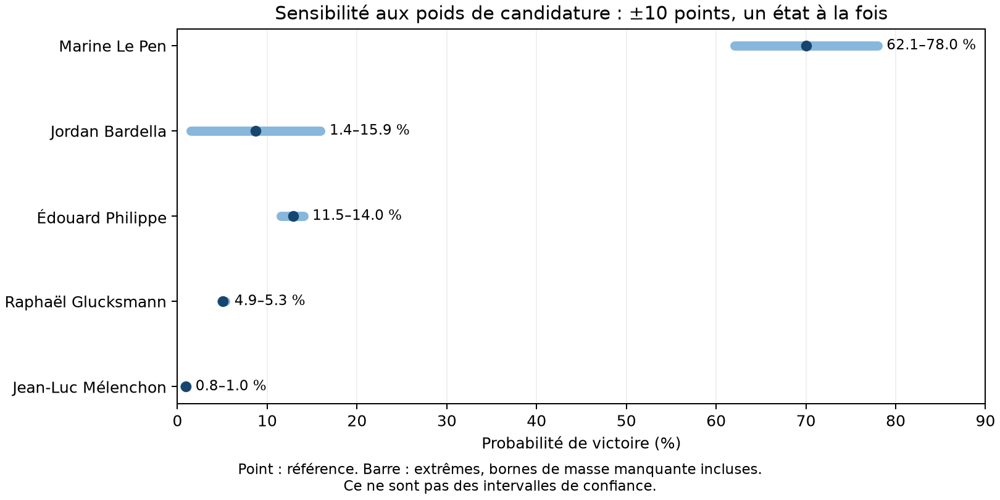

# 10 — Référence figée et consolidation chronologique

Protocole fixé le 22 octobre 2026 avant lecture des nouveaux scores. Configuration :
`data/registry/reference_2026-10-22.yaml`. Aucune option ne sera sélectionnée sur ces scores.

## Référence

La référence conserve les choix de la projection publiée du 22 octobre : substitution,
calibration de l'erreur finale élargie, biais du second tour par horizon ; autres variantes
désactivées. C'est une référence de comparaison, pas une nouvelle admission statistique.
La substitution et la courbe de biais gardent leur statut de choix publiés sans admission
stricte. Les paramètres des priors et de l'inférence sont explicites.

Un gel conserve le code Python, le verrou uv, les registres, les tables utilisées, les
tirages de la projection publiée et leurs empreintes SHA-256. Les calculs s'exécutent sur
cette copie avec VVS_ROOT et PYTHONPATH, indépendamment du répertoire de travail courant.
Une reprise vérifie les empreintes et ne rejoue que les étapes absentes.
Le verrou versionné `data/registry/reference_2026-10-22.lock.json` épingle le commit et
les entrées : même une recréation dans un dossier vide reprend le code `a89d304` et exige
les mêmes empreintes et versions de dépendances. Cette recréation a été testée après
l'avancement du dépôt par des travaux parallèles.
Le coordinateur et les exports peuvent recevoir des corrections de maintenance ; les
sous-processus de calcul statistique et de sensibilité utilisent toujours les sources du
gel. Lors de ce run, l'assemblage des tableaux a été corrigé pour accepter une somme de
voix non couvertes égale à zéro stockée comme entier. Cette promotion entier/décimal ne
modifie aucun score, tirage ou fichier de cas ; un test de régression la protège.

Référence exécutée : commit **`a89d304`**, 165 fichiers figés sous
`runs/2026-10-22-consolidation/`. Les sources d'autres travaux non committés ne sont pas
prises dans le gel. Les anciens tirages publiés conservent leur propre manifest et leur
commit ; le commit de consolidation identifie le code du nouvel évaluateur.
Le tag Git **`reference-2026-10-22`** conserve le bilan et le coordinateur corrigé ;
le manifest continue d'identifier `a89d304` comme code statistique exécuté.

Provenance Git : le gel est une copie, pas un worktree. L'ancien champ `commit` du
manifest d'ajustement interrogeait le dépôt parent ; celui de 2022 à sept jours indique
ainsi `9561556`, committé par un autre travail pendant le calcul. Les empreintes confirment
que ce cas a exécuté `a89d304`, comme les onze autres. L'audit conserve ce champ sous
`fit_manifest_git_hint` et identifie séparément `statistical_source_commit`. Les fichiers
de cas originaux sont préservés. Le coordinateur transmet désormais `VVS_SOURCE_COMMIT` ;
les prochaines versions de code figées embarqueront le correctif qui lit cette valeur.

Depuis la racine, `scripts/run_consolidation.sh` lance ou reprend le calcul. Depuis
`back/`, le gel se contrôle séparément avec :

```sh
uv run python -m vvs.eval.consolidation verify --out ../runs/2026-10-22-consolidation
uv run python studies/consolidation_report.py --run ../runs/2026-10-22-consolidation
```

Le second script exige les douze cas terminés, vérifie les empreintes des sorties et la
cohérence des tirages, puis écrit `review/` (CSV, audit JSON et figures). Ce bilan compact
est conservé dans `docs/results/consolidation-2026-10-22/`. Les tirages et le gel complet
restent dans `runs/`, hors Git : il faut conserver ce dossier pour une reprise exacte.

## Évaluation chronologique

Élections : 2012, 2017, 2022 ; horizons : 180, 90, 30, 7 jours. 2002 et 2007 fournissent
l'amorçage : deux présidentielles antérieures sont requises pour estimer la participation.
Tous les paramètres appris (erreur, forme internationale, reports, participation) ne voient
que les scrutins terminés avant la date de prévision. Les scrutins de liste postérieurs sont
exclus, ainsi que les enquêtes de reports dont le terrain est postérieur à cette date.

Un sondage entre après sa publication ; si cette date manque, disponibilité = fin du
terrain + 2 jours. L'audit rapporte les effectifs sous des délais 0, 2, 4 et 7 jours.
Les dates manquantes sont imputées, pas présentées comme retrouvées. Les bases historiques
et les classifications politiques restent reconstruites aujourd'hui : ce protocole teste
une calibration chronologique, pas une sélection du modèle historiquement aveugle, ni les
versions exactes des bases disponibles à chaque époque.

Avant la liste officielle, les scénarios sont les configurations effectivement testées
dans les 30 derniers jours disponibles (élargissement jusqu'à 180 jours en cas de vide).
Chaque sondage pèse un, partagé entre ses hypothèses ; les configurations identiques sont
regroupées. Ces fréquences sont une approximation de l'offre de candidats, pas des
probabilités éditoriales reconstituées. Après publication, la liste officielle est utilisée.
Les noms des vainqueurs de primaires et des finalistes ne sont jamais injectés après coup.
Les candidats absents des scénarios gardent une probabilité nulle, même s'ils ont gagné.
Les listes historiques portent tous leurs candidats explicitement ; elles n'utilisent
pas la loi de présence des petits candidats propre à 2027. La couche historique de
scénarios constitue donc elle-même une approximation évaluée par le score global.

La simulation tire le scénario, le premier tour et son erreur, les deux qualifiés, puis le
second tour propre à chaque duel. Les sondages de duel sont conditionnels : ils ne modifient
pas le poids préalable des duels. Scores : log-score du vainqueur et de la paire, Brier de
victoire (somme multicatégorie), Brier de qualification, CRPS et couverture du premier tour.
Le CRPS inclut tous les candidats officiels, avec zéro pour ceux non prévus. Le Brier inclut
aussi les candidats envisagés mais finalement absents. Aucun report ex post des voix.

Les fréquences brutes et leurs zéros sont publiés. Pour le log-score, lissage de Jeffreys
sur l'univers de score (union des candidats prévus et officiels), explicitement séparé de
la probabilité publiée. Une moyenne par horizon donne le même poids aux trois élections.
Le diagnostic du second tour sur le duel réalisé reste séparé du score de victoire global.

Le témoin `mean14d` remplace seulement l'agrégateur bayésien par la moyenne des sondages
disponibles des 14 derniers jours (une mesure par sondage et candidat). Si la fenêtre est
vide, il prend la dernière date disponible ; un candidat absent de cette fenêtre prend
sa médiane passée, ou 1 % en l'absence de toute observation. Il conserve les mêmes scénarios,
l'erreur électorale et le modèle du second tour. La comparaison isole donc l'apport de
l'agrégation, sans constituer une ablation de chaque composant.

## Sensibilité aux scénarios 2027

Même modèle et mêmes tirages ; seuls changent les poids des six dimensions : ±10 points
pour un état (autres états renormalisés), états certains, puis poids uniformes. Les
contraintes sont réappliquées avant normalisation. Les petits candidats conservent leur loi.
Les configurations sont appariées par leurs états, jamais par leur rang après tri.

Les tirages sont repondérés par configuration, avec correction des effectifs entiers du
tirage stratifié. On rapporte qualification, victoire, présence, écarts à la référence,
taille effective et masse des configurations sans tirage. Cette masse donne des bornes
explicites sur les probabilités ; elle n'est jamais supprimée silencieusement. Une faible
taille effective est signalée. Les états certains sont des conditions, pas des prévisions
de candidature ni des effets causaux d'un retrait.

## Résultats chronologiques

Douze cas terminés, 40 000 tirages par modèle et par cas. Le témoin partage les
scénarios, la loi d’erreur et le modèle du second tour avec la référence ; les écarts
mesurent donc l’apport de l’agrégateur. Les moyennes donnent le même poids aux trois
élections. Un log-score plus haut et un CRPS plus bas sont préférables.

| Horizon | Log victoire réf. / témoin | Log paire réf. / témoin | CRPS réf. / témoin | Couverture 90 % réf. / témoin |
|---|---|---|---|---|
| 180 | -0.938 / -1.113 | -1.278 / -1.433 | 2.869 / 2.889 | 66.5 % / 69.8 % |
| 90 | -0.518 / -0.510 | -1.100 / -1.089 | 1.976 / 1.956 | 79.2 % / 79.2 % |
| 30 | -0.116 / -0.124 | -0.417 / -0.417 | 1.508 / 1.556 | 85.6 % / 85.6 % |
| 7 | -0.106 / -0.073 | -0.268 / -0.190 | 0.865 / 0.933 | 91.7 % / 91.7 % |



Détail de la référence (les deux modèles, les Brier et les autres métriques sont
dans les CSV versionnés) :

| Scrutin | Horizon | P(vainqueur réel) | P(paire réelle) | CRPS | Voix finales hors support |
|---|---|---|---|---|---|
| 2012 | 180 | 93.4 % | 70.8 % | 1.580 | 0.25 % |
| 2012 | 90 | 84.0 % | 59.9 % | 1.238 | 0.25 % |
| 2012 | 30 | 89.2 % | 80.2 % | 0.872 | 0.00 % |
| 2012 | 7 | 96.3 % | 93.1 % | 0.740 | 0.00 % |
| 2017 | 180 | 8.0 % | 5.9 % | 4.602 | 28.50 % |
| 2017 | 90 | 32.1 % | 17.7 % | 1.902 | 2.13 % |
| 2017 | 30 | 81.8 % | 64.8 % | 1.483 | 0.00 % |
| 2017 | 7 | 76.3 % | 54.2 % | 0.576 | 0.00 % |
| 2022 | 180 | 80.3 % | 51.9 % | 2.426 | 0.00 % |
| 2022 | 90 | 78.3 % | 34.9 % | 2.788 | 0.00 % |
| 2022 | 30 | 96.7 % | 55.1 % | 2.170 | 0.00 % |
| 2022 | 7 | 99.2 % | 88.8 % | 1.278 | 0.00 % |

Diagnostics : **12/12 ajustements conformes**, R-hat maximal 1.0079,
ESS minimale des parts à la date de prévision 3073, 0 divergence(s).
Ces contrôles portent sur l’inférence numérique, pas sur la validité prédictive.

Toutes les dates de publication historiques des cas retenus manquent : le délai
imputé de deux jours s’applique donc partout. La calibration de 2012 ne voit que
2002 et 2007 ; celle de 2017 ajoute 2012 et les européennes 2014 ; celle de 2022
ajoute 2017 et les européennes 2019. Les législatives 2022 et les scrutins 2024
n’entrent jamais dans ces plis. Les dates internationales et les sources de reports
effectivement utilisées sont conservées cas par cas dans l’audit.

Résultats et empreintes : [bilan versionné](results/consolidation-2026-10-22/README.md).

### Lecture du bilan

La référence ne domine pas la moyenne sur 14 jours. Son gain moyen de log-score de
victoire à 180 jours est de **+0,175**, principalement porté par 2017. Elle perd **0,008**
à 90 jours et **0,032** à sept jours. À sept jours, le CRPS s'améliore de 0,068 point,
mais le log-score de la paire de qualifiés se dégrade de 0,079. Améliorer les parts de
vote et améliorer les probabilités des événements sont donc deux objectifs à vérifier
séparément. Aucun nouveau composant n'est admis sur la base de ce bilan.

La couverture globale à 180 jours reste faible (66,5 % pour un intervalle nominal à
90 %). Les scénarios y contribuent : en octobre 2016, Fillon, Hamon, Asselineau et
Lassalle sont absents des configurations récemment sondées, soit **28,5 % des voix
finales hors support**. Le protocole pénalise cette omission au lieu de transférer leurs
voix à des candidats déjà envisagés. Cela limite surtout la reconstruction historique
choisie ici ; ce seul résultat ne permet pas d'attribuer le défaut à la loi d'erreur.

Les prolongements prioritaires sont la récupération des dates de publication, une étude
des candidatures non couvertes par les hypothèses récentes, puis des ablations
chronologiques séparées de la substitution et de la courbe de biais du second tour.
Ces études devront annoncer leurs protocoles avant de choisir une nouvelle référence.
Trois élections fournissent trois issues indépendantes par horizon ; les douze dates
ne suffisent pas à valider finement la calibration des probabilités de victoire.

Validation technique : **732 tests passent**, contrôle des 960 000 tirages historiques
(12 cas × 2 modèles × 40 000), et reprise complète réussie sans modification des
96 fichiers d'ajustement (empreintes et dates inchangées). Les douze cas restent
conformes après cette reprise. Le verrou de lancement concurrent a également été testé.

## Résultats de sensibilité

47 variantes nommées, 33 candidats ; certaines perturbations d'états d'une dimension
binaire sont équivalentes, ce ne sont pas 47 expériences indépendantes.
Les variations locales de ±10 points donnent les étendues
suivantes de probabilité de victoire (arrondies à 0,1 point) :

| Candidat | Référence | Étendue locale |
|---|---|---|
| Marine Le Pen | 70,0 % | 62,1–78,0 % |
| Jordan Bardella | 8,7 % | 1,4–15,9 % |
| Édouard Philippe | 12,9 % | 11,5–14,0 % |
| Raphaël Glucksmann | 5,0 % | 4,9–5,3 % |
| Jean-Luc Mélenchon | 0,9 % | 0,8–1,0 % |



La variation individuelle du RN reflète surtout le partage du poids de candidature entre
Le Pen et Bardella. Leur probabilité de victoire **cumulée** varie beaucoup moins : environ
77,6–79,7 % dans ces perturbations locales. Cette stabilité concerne les poids testés ;
elle ne mesure pas la sensibilité au modèle d'erreur, aux blocs ou aux reports.

La référence laisse 0,012 % de masse sans tirage, ce qui rend les bornes très étroites.
Deux variantes sont fragiles : « Knafo certaine » a environ 795 tirages effectifs et
0,304 % de masse manquante ; les poids uniformes ont environ 649 tirages effectifs et
**14,286 % de masse manquante**. Cette dernière variante exige de simuler les configurations
supplémentaires avant d'interpréter un chiffre central comme une prévision complète.
Les bornes de masse manquante restent distinctes de l'incertitude Monte-Carlo.

Les CSV donnent présence, qualification et victoire pour chaque candidat et variante,
ainsi que les bornes et écarts à la référence. Les états certains sont à lire comme des
conditions ; les étendues ci-dessus ne sont pas des intervalles de confiance.
