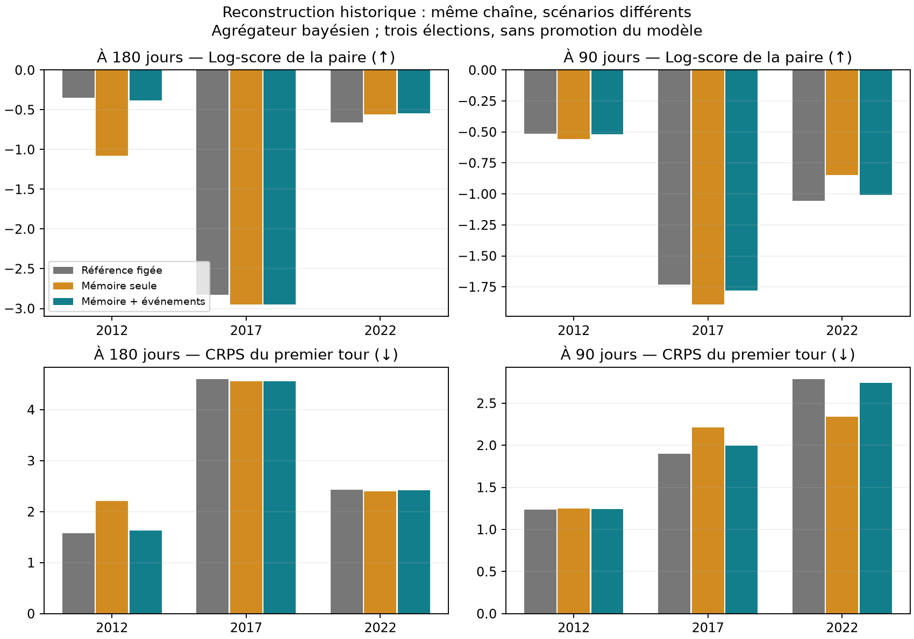

# 11 — Reconstruction des scénarios historiques

Protocole déclaré le 22 octobre 2026 **avant calcul des variantes**. La référence
`reference-2026-10-22`, ses sources et ses résultats restent inchangés. Paramètres de
l'étude : `data/registry/historical_scenarios_2026-10-22.yaml`.

## Hypothèse et variantes

La fenêtre récente de 30 jours peut éliminer un candidat déjà observé. On teste une
mémoire de **365 jours**, avec décroissance exponentielle de **demi-vie 60 jours**.
Ces deux durées sont des choix de protocole communs aux trois élections, sans recherche
de paramètres sur les scores. Un sondage reçoit le poids `2 ** (-âge / 60)` ; ce poids
est partagé également entre ses ensembles distincts de candidats. Les configurations
identiques sont regroupées et les poids normalisés. Les hypothèses restent des listes
complètes effectivement sondées : aucune combinaison de candidats n'est inventée.

- `memory` : cette mémoire seule, ablation du filtre événementiel.
- `memory_events` : variante principale, même mémoire puis exclusion des configurations
  incompatibles avec les événements déjà connus. Un retrait exclut le candidat ; une
  désignation exclut les autres candidats du même parti, selon l'affiliation à l'année
  de l'événement dans le registre. On élimine la configuration entière et renormalise ;
  on ne remplace jamais un candidat par le vainqueur d'une primaire.

Les événements viennent exclusivement du **registre déjà figé**, pour l'élection
concernée, à partir du lendemain de leur date. Seuls `withdrawal` et `primary` agissent.
Les candidats et événements futurs ne peuvent pas enrichir le support. Les déclarations
ne créent pas de candidat sans sondage. La liste officielle remplace les scénarios
exactement à la même date que dans la référence. Un ensemble admissible vide est une
erreur explicite ; aucune reprise silencieuse de la référence.

Le filtre par parti est une approximation de désignation, pas une liste exhaustive de
participants aux primaires. Le registre des événements, constitué pour une autre étude,
est incomplet ; les affiliations n'ont qu'une résolution annuelle et sont rétrospectives.
Il peut donc rester des hypothèses périmées ou en disparaître trop. L'audit conservera les
événements appliqués, les candidats exclus et la masse supprimée. Les sources datées du
registre seront conservées avec l'audit ; aucune nouvelle chronologie n'est déduite des
résultats présidentiels.

## Comparaison fixée

Mêmes douze cas (2012, 2017, 2022 × 180, 90, 30, 7 jours), disponibilité des données,
calibrations chronologiques, priors, 40 000 simulations, graine et métriques que dans
[la consolidation](10-consolidation.md). Les variantes s'appliquent à l'agrégateur
bayésien **et** au témoin `mean14d`. Les ajustements bayésiens figés sont réutilisés
uniquement si tous les candidats demandés figurent déjà dans leurs tirages ; sinon
l'étude s'arrête. Leur estimation ne dépend pas des poids des scénarios. Les fonctions
de simulation et de score sont celles du gel `a89d304`, importées depuis sa copie.

Un rejeu des scénarios originaux vérifiera les résultats numériques avant comparaison.
Les cas dont les configurations restent identiques réutiliseront les sorties validées.
Les scénarios reconstruits, probabilités de présence, scores détaillés, diagnostics et
empreintes seront écrits dans un dossier d'étude distinct. Une reprise vérifiera les
entrées et sorties ; aucun fichier du gel ne sera réécrit.

Critères de lecture inchangés : log-score de la paire et CRPS à 180 et 90 jours, signe
par élection, couverture, absence de dégradation aux autres horizons ; log-score et
Brier de victoire également publiés. Aucune variante ne sera promue automatiquement.
On publiera aussi les voix finales hors support et les probabilités de présence :
ajouter un candidat avec une probabilité infime ne suffit pas à bien le prévoir.

Cette comparaison est exploratoire après constat du défaut sur les mêmes élections,
et non un nouveau test indépendant. Trois élections ne permettent pas de conclure à
une amélioration générale. La même graine ne garantit pas des tirages appariés quand
les configurations changent ; les petits écarts restent soumis au bruit Monte-Carlo.
Un candidat jamais sondé dans les données disponibles demeure absent, notamment Hamon
à 180 jours de 2017. Une mémoire plus longue ne corrige pas cette limite.

## Résultats

**Aucune variante admise.** Le protocole a été committé dans `01bd100` avant le calcul.
La mémoire étend le support, mais ne domine pas la référence sur les métriques annoncées.
Les écarts suivants sont variante moins référence, moyennés à poids égal par élection,
avec l'agrégateur bayésien. Positif préférable pour les log-scores, négatif pour le CRPS.
La couverture est exprimée en points de pourcentage.

| Variante | Horizon | Δ log victoire | Δ log paire | Δ CRPS | Δ couverture 90 % |
|---|---|---|---|---|---|
| Mémoire seule | 180 j | −0,2740 | −0,2508 | +0,1861 | +6,11 |
| Mémoire + événements | 180 j | −0,0426 | −0,0153 | −0,0011 | +2,78 |
| Mémoire seule | 90 j | −0,0719 | +0,0004 | −0,0431 | −0,25 |
| Mémoire + événements | 90 j | −0,0156 | −0,0005 | +0,0160 | 0,00 |

À 30 et 7 jours, tous les écarts sont exactement nuls : mêmes listes officielles et
réutilisation des mêmes tirages. Les écarts proches de zéro ne permettent pas de conclure
à une amélioration, compte tenu du bruit Monte-Carlo et des trois seules élections.



### Ce qui change selon l'élection

Variante principale `memory_events`, toujours avec l'agrégateur bayésien :

| Scrutin | Horizon | Δ log victoire | Δ log paire | Δ CRPS | Voix finales hors support, réf. → variante |
|---|---|---|---|---|---|
| 2012 | 180 j | −0,0008 | −0,0377 | +0,0474 | 0,25 → 0,25 % |
| 2017 | 180 j | −0,1367 | −0,1241 | −0,0416 | 28,50 → 6,36 % |
| 2022 | 180 j | +0,0097 | +0,1160 | −0,0092 | 0 → 0 % |
| 2012 | 90 j | −0,0019 | −0,0036 | +0,0019 | 0,25 → 0,25 % |
| 2017 | 90 j | −0,0496 | −0,0451 | +0,0957 | 2,13 → 2,13 % |
| 2022 | 90 j | +0,0048 | +0,0472 | −0,0496 | 0 → 0 % |

Le log-score de la paire ne progresse que pour 2022 aux deux horizons longs. À 90 jours,
le CRPS se dégrade aussi en moyenne. La variante principale ne satisfait donc pas les
critères de progression annoncés, malgré une couverture à 180 jours passant de 66,52 %
à 69,29 %. Cette couverture reste très inférieure au niveau nominal de 90 %.

Le témoin `mean14d` confirme l'absence de domination : avec `memory_events`, à 180 jours,
Δ log victoire = −0,0518, Δ log paire = −0,0351 et Δ CRPS = −0,0198 ; à 90 jours,
ces écarts sont −0,0009, +0,0011 et +0,0135. Sa couverture à 180 jours baisse de
0,56 point. Les deux agrégateurs et tous les Brier figurent dans les CSV.

### Pourquoi ajouter des noms ne suffit pas

En 2017 à 180 jours, Fillon, Asselineau et Lassalle reviennent dans les configurations.
Hamon reste absent : il n'est pas encore observé dans les sondages disponibles du gel.
La part de voix finales hors support baisse donc de 28,50 % à 6,36 %, mais les poids
de présence reconstruits restent faibles : **4,68 % pour Fillon**, **0,33 % chacun pour
Asselineau et Lassalle**. Fillon garde une part nulle dans plus de 95 % des tirages :
l'intervalle central à 90 % ne couvre toujours pas son résultat. Le CRPS global ne
gagne que 0,042 point et la couverture de ce cas reste inchangée.

L'élargissement ramène aussi des listes anciennes sans Macron : sa présence passe de
45,24 % à 39,58 %, et sa probabilité de victoire de 7,99 % à 6,97 %. Le gain de support
ne compense donc pas la dégradation des probabilités de la paire et du vainqueur réels.
Les fréquences de test des instituts ne sont pas des probabilités de candidature fiables.

À 90 jours de 2017, la mémoire seule ramène Asselineau et Lassalle, mais uniquement dans
une ancienne liste contenant aussi Hollande et d'autres candidats exclus par le filtre.
La suppression de cette liste entière les fait à nouveau disparaître dans `memory_events`.
La masse de scénarios supprimée atteint **38,24 %**. La dépendance à des listes complètes
rend ainsi l'enrichissement fragile : un retrait obsolète peut effacer un candidat distinct.

L'ablation explique l'intérêt du calendrier : en 2012 à 180 jours, la mémoire seule
réintroduit d'anciennes hypothèses socialistes après la désignation déjà connue de
Hollande. Le filtre élimine 49,63 % de masse ; la forte perte de log-score de victoire
de la mémoire seule (−0,690) disparaît presque (−0,001). Il reste cependant des scénarios
anciens dont la validité n'est pas garantie par ce registre incomplet. Le filtre par parti
peut aussi exclure un dissident qui n'a pas participé à une primaire : l'audit détaille
ses décisions, sans les présenter comme des retraits individuellement vérifiés.

Les métriques sont strictement celles du gel. L'univers de score peut s'élargir avec
les candidats ajoutés : le dénominateur du lissage de Jeffreys et celui du Brier moyen
de qualification changent donc aussi. Il faut lire ce dernier avec les probabilités
brutes et le Brier de victoire, sans confondre baisse par dilution et meilleur pronostic.

## Reproduction et contrôles

Depuis la racine :

```sh
scripts/run_historical_scenarios.sh
```

Depuis `back/`, pour produire le bilan compact dans `review/` :

```sh
uv run python studies/historical_scenarios_report.py --run ../runs/2026-10-22-historical-scenarios --reference ../runs/2026-10-22-consolidation
```

Le script refuse un dossier d'étude inclus dans la référence, vérifie le verrou versionné,
les dépendances et **409 fichiers de référence** (entrées et sorties, caches Python exclus).
Il conserve ses sources et le protocole dans le dossier séparé de l'étude. La reprise
des douze cas terminés a été testée et ne relance aucune simulation. Un verrou empêche
deux lancements concurrents sur le même dossier.

Les 24 rejeux de référence reproduisent exactement candidats, scénarios, qualifiés et
vainqueurs ; l'écart maximal sur les parts est de **2,85 × 10⁻¹⁴ point**, simple arrondi
numérique, sous la tolérance de rejeu de 10⁻¹². Aucun ajustement bayésien n'a été relancé.
Les sorties des variantes représentent 1 920 000 tirages contrôlés (12 × 2 agrégateurs ×
2 variantes × 40 000), dont 960 000 repris à l'identique après publication des listes.
Toutes les configurations ont au moins un tirage ; aucune masse n'est perdue. Le ratio
ESS/effectif minimal au second tour vaut 0,494, sans cellule sous 0,1. Ces diagnostics
valident l'exécution, pas la qualité prédictive. Les empreintes de la référence sont
inchangées avant et après l'étude et sa reprise.
La suite complète passe : **737 tests**, avec quatre avertissements préexistants
(deux calculs intermédiaires logarithmiques, deux dépréciations Polars). Les nouveaux
tests protègent la pondération des sondages, la déduplication des hypothèses, la frontière
temporelle des événements, l'absence d'injection du futur vainqueur et les échecs explicites.

Résultats détaillés, présence des candidats, audit des événements et figure :
[bilan versionné](results/historical-scenarios-2026-10-22/README.md).

## Suite suggérée par ce résultat

La prochaine reconstruction devrait distinguer les choix de candidats par famille de
candidatures des listes complètes testées par les instituts. Il faudra constituer des
états datés (déclaration, participation à une primaire, retrait, désignation), avec leurs
sources de publication, puis expliciter les règles de compatibilité et la masse réservée
aux candidats encore non sondés. Le calendrier devra couvrir également les candidatures
finalement absentes, pour éviter un registre construit autour des seuls candidats réels.

Une telle méthode devra annoncer ses probabilités et son protocole avant de rejouer les
scores ; ce résultat ne justifie pas de régler après coup la fenêtre, la demi-vie ou les
poids de Fillon et de Hamon. La référence figée et la projection 2027 restent inchangées.
