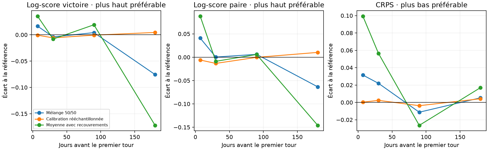

# Expériences de structure — 23 octobre 2026

Moyennes de trois élections, poids égaux. Résultats exploratoires ; aucune admission.



| variant | horizon | delta_log_score_winner | delta_log_score_pair | delta_crps | delta_coverage90 |
|---|---|---|---|---|---|
| calibration_bootstrap | 7 | -0.0008 | -0.0061 | +0.0003 | +0.0000 |
| calibration_bootstrap | 30 | -0.0058 | -0.0132 | +0.0024 | +0.0000 |
| calibration_bootstrap | 90 | -0.0007 | -0.0004 | -0.0038 | +0.0000 |
| calibration_bootstrap | 180 | +0.0044 | +0.0103 | +0.0042 | +0.0000 |
| ensemble50 | 7 | +0.0165 | +0.0410 | +0.0315 | +0.0000 |
| ensemble50 | 30 | -0.0040 | +0.0003 | +0.0220 | +0.0000 |
| ensemble50 | 90 | +0.0041 | +0.0061 | -0.0113 | +0.0000 |
| ensemble50 | 180 | -0.0756 | -0.0635 | +0.0053 | +0.0000 |
| rolling_overlap | 7 | +0.0355 | +0.0880 | +0.0994 | +0.0000 |
| rolling_overlap | 30 | -0.0081 | -0.0088 | +0.0565 | +0.0000 |
| rolling_overlap | 90 | +0.0190 | +0.0058 | -0.0264 | -0.0278 |
| rolling_overlap | 180 | -0.1721 | -0.1460 | +0.0170 | +0.0333 |

Les écarts positifs favorisent les log-scores ; les écarts négatifs favorisent le CRPS.
La couverture est une fraction, pas un nombre de points.

Les témoins mean14d, GLS éclairci et GLS indépendant figurent dans comparisons.csv.
La covariance des rollings est une hypothèse fondée sur les terrains, pas une mesure
du chevauchement des répondants. La calibration rééchantillonnée est conditionnelle
aux biais, à gamma et à nu fixés. Les scénarios incomplets du gel restent identiques.

## Diagnostics

- 12 cas ; 96 lignes de scores ; référence inchangée
  (409 fichiers contrôlés).
- 384 calibrations pondérées, optimisations convergées.
- Substitution : substitution_means.csv et substitution_fits.json, tests séparés
  leave-one-election-out et chronologiques ; pas de projection électorale si le pilote échoue.
- Indécis : panel_audit.json ; aucun identifiant individuel ni microdonnée dans ce bilan.

## Reproduction

Depuis la racine, avec le gel disponible :

```sh
bash scripts/run_structure_study.sh
cd back
uv run --no-sync python studies/structure_report.py --run ../runs/2026-10-23-structure-v2 --out ../docs/results/structure-2026-10-23
```

Les trajectoires complètes restent dans runs/, hors Git. Le script de reprise vérifie
les empreintes des sources et des sorties avant de sauter une étape terminée.
